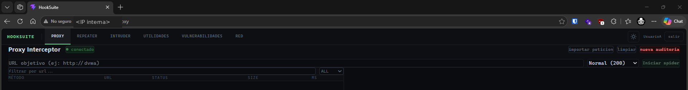

# RF-09 (Red/DevTools) — qué había de verdad antes de sacrificarlo

**Fecha:** 2026-10-11 · **Capturado por:** Claude, en la cocina del mediaserver (R1), antes de retirar nada.
**Para qué:** dejar por escrito, contra el código, por qué se sacrifica RF-09.

> 🔧 **ESTE DOCUMENTO SE CORRIGIÓ A SÍ MISMO EL MISMO DÍA, Y SE DECLARA (R9).** Su primera versión afirmaba
> que el enunciado del pendiente de RF-09 («dos llamadas a endpoints que no existen, rutas de Windows e IP
> hardcodeada») estaba **mal en dos de sus tres puntos**. Era **falso**, y el error era de método mío:
> busqué las dos llamadas **solo** dentro de `devtools/` y bajo el prefijo `/api/network`, cuando una de las
> dos es de **Playwright** a `/api/ia/fingerprint`; y busqué la IP fija por el patrón `192.168`, cuando la
> IP fija es la **de producción**. Los tres ceros que obtuve eran **falsos ceros**. El pendiente estaba
> bien; lo que estaba mal era mi comprobación. Lo que sigue es la versión verificada.

## 1. Los dos endpoints que no existen — son dos, y están en dos componentes distintos

| Quién llama | A qué llama | ¿Existe? |
|---|---|---|
| `playwright/utils/reporter.py` (`send_fingerprint`) | `POST /api/ia/fingerprint` | ❌ **No.** 0 coincidencias de `fingerprint` en `backend/routes/` y `backend/main.py` |
| `devtools/utils/reporter.py:63` (`send_console_finding`) | `POST /api/network/console_finding/{token}` | ❌ **No.** No está entre los 5 endpoints de `backend/routes/network.py` |

Lo que **sí** existe en `backend/routes/network.py` (montado en `main.py:150`, prefijo `/api/network`):

    network.py:33    POST  /packet
    network.py:51    POST  /packet/{session_token}      <-- esta la usa devtools/utils/reporter.py:45 y SI funciona
    network.py:62    GET   /packets/{session_token}
    network.py:68    POST  /session_cookie
    network.py:74    GET   /session_cookie/{host:path}

Es decir: el capturador CDP **sí consigue enviar los paquetes** (`:45`), y **pierde contra un 404 todos los
hallazgos de consola** (`:63`). La mitad del valor de RF-09 nunca llegó al producto.

## 2. Las rutas de Windows — reales, y rompen la portabilidad

`devtools/core/chrome_launcher.py:18-19`:

    r"C:\Program Files\Google\Chrome\Application\chrome.exe"
    r"C:\Program Files (x86)\Google\Chrome\Application\chrome.exe"

Rutas absolutas de Windows hardcodeadas para localizar Chrome. **Los contenedores del producto son Linux**,
así que este lanzador solo funciona en la máquina de desarrollo de quien lo escribió. Encaja con lo que la
memoria ya anotaba el 6-oct: el grupo desarrolla en Windows (de ahí también los finales de línea CRLF que
hicieron fallar dos `sed` en silencio).

> Matiz, para que nadie lo confunda: `devtools/analyzers/console_analyzer.py:8` **también** contiene `C:\`,
> en la forma `(r'C:\\', "SERVER_PATH_EXPOSED")` — pero ahí **es una característica**, un patrón que detecta
> rutas de servidor expuestas en la consola del navegador. No es el defecto; el defecto son las dos de
> `chrome_launcher.py`.

## 3. La IP fija — y arrastra dos cosas más ya muertas

`devtools/core/chrome_launcher.py:39`:

    "--proxy-pac-url=http://<IP de produccion>:8000/api/proxy/proxy.pac"

Tres cosas rotas en una línea: la **IP de producción fija**, el **puerto 8000 que se cerró en la Fase 1**, y
la **ruta PAC que se jubiló** (el modelo PAC se retiró al pivotar RF-02 a `httpx`; ver LINEA.md). Esta línea
no puede funcionar en ningún entorno actual.

> 🔴 **Hallazgo colateral para el apartado 8:** esa IP de producción está escrita en claro en un
> **repositorio público**. No es una credencial, pero es superficie de ataque regalada, y es el mismo patrón
> del incidente de la clave en el `.env`. Candidato a parametrizar por entorno antes de la entrega.

## 4. La pestaña del front era pasiva

`frontend/src/pages/network/NetworkPage.jsx` (113 líneas) importaba solo `useSession`, `useWebSocket` y
`Badge`: **ni un `fetch`, ni un `axios`, ni una URL**. Solo pintaba los paquetes que llegaban por WebSocket.
Los 404 nunca salieron de la pestaña, sino de los dos capturadores, que son procesos aparte.

## 5. Por qué se sacrifica, dicho de una vez

RF-09 necesita un capturador CDP que **se lanza a mano y solo arranca en Windows**, manda sus hallazgos de
consola a un **endpoint que no existe**, apunta a una **IP, un puerto y una ruta que ya no están**, y
alimenta una pestaña que solo pinta en pasivo. No es una pantalla que pulir: es un vertical entero sin
terminar, a dos días de congelar. Se retira del front y pasa al apartado de trabajo futuro.

## 6. Lo que queda vivo detrás, y por qué no se toca

- `backend/routes/network.py` **se queda**: sus endpoints los consumen `ia/orchestrator.py` y `playwright/`
  (declarado en `main.py:158`). Quitarlos rompería RF-08, que empezó a funcionar el 10-oct.
- `networkPackets` en `AppContext.jsx` y `hooks/useWebSocket.js` **se queda** por ahora: vive en la vía del
  WebSocket que alimenta las cinco pestañas restantes, y no se toca en mitad del pulido. La memoria ya tenía
  anotado (6-oct) que `hooks/useWebSocket.js` es un **segundo** WebSocket usado por Vulnerabilidades y Red;
  al irse Red, queda como consumidor único Vulnerabilidades. Unificarlo es limpieza, no urgencia.
- `devtools/` **se queda en el repo**: es trabajo hecho, va al apartado de trabajo futuro, no se borra.

## 7. Captura de evidencia (R6)

**Pie para la memoria:** *Barra de navegación de HookSuite **antes** de retirar RF-09: seis pestañas, con
**RED** en último lugar. Capturada por josemax en la cocina el 11-oct-2026, antes de aplicar el cambio, por
exigencia de R6 (la evidencia la destruyen nuestros propios arreglos). La IP interna de la barra de
direcciones va **censurada**; se publica solo la copia censurada (R7). Dos resoluciones disponibles:
`RF-09-pestana-red-antes-de-retirar.png` (completa, para el PDF) y `-reducida.png` (1100 px, para el
artefacto).* **Requisitos: RF-09** (retirado) y **RF-01** (interfaz, que pasa de 6 a 5 pestañas).

> **De las tres capturas pedidas solo se tomó esta, y es deliberado.** Las otras dos (la pestaña Red abierta
> y la consola con el 404 de `console_finding`) no se tomaron: el defecto técnico ya está capturado **como
> texto** en los §1–§3 de este mismo documento, que para esto es mejor evidencia que una foto —es buscable,
> comparable y no corre el riesgo de publicar una credencial (R3)—. La que sí era irrepetible era la de la
> interfaz, y está.
